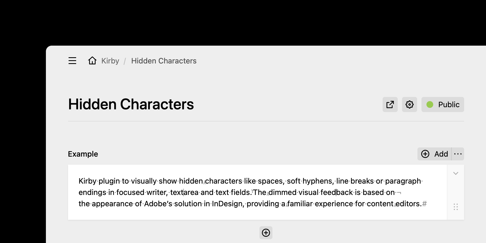

# Kirby Hidden Characters

[Kirby CMS](https://getkirby.com) plugin to visually show hidden characters like spaces, soft hyphens, tabs, line breaks, or paragraph endings in focused [writer](https://getkirby.com/docs/reference/panel/fields/writer), [textarea](https://getkirby.com/docs/reference/panel/fields/textarea), and [text fields](https://getkirby.com/docs/reference/panel/fields/text). The dimmed visual feedback is inspired by Adobe InDesign's hidden-characters mode, providing a familiar experience for content editors.



## Requirements

- Kirby 5.2+
- PHP 8.2+

## Installation

```bash
composer require grommasdietz/kirby-hidden-characters
```

> [!TIP]
> If you don’t use Composer, you can download this repository and copy it to `site/plugins/kirby-hidden-characters`.

## Quickstart

This plugin works out of the box with no configuration required.

### Documentation

Full reference for [usage](docs/usage/index.md), [contributions](docs/contributions/index.md) and [maintenance](docs/maintenance/index.md) lives in [documentation](docs/index.md).

---

## Credits

The original mirroring approach was adapted from the [Kirby Soft Hyphens](https://github.com/hansipete/kirby-soft-hyphens) plugin by [@hansipete](https://github.com/hansipete). Thank you!

---

## Changelog

See [CHANGELOG.md](CHANGELOG.md) for version history and changes.

---

## Security

See [SECURITY.md](SECURITY.md) for security policies and reporting vulnerabilities.

---

## Contributing

See [CONTRIBUTING.md](CONTRIBUTING.md) for guidance and expectations.

---

## License

[MIT](LICENSE.md) © 2024–2026 Grommas Dietz
